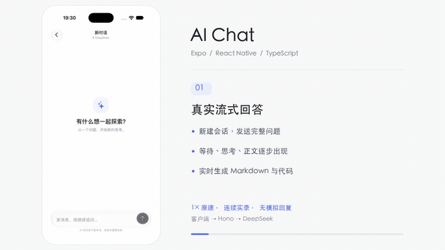
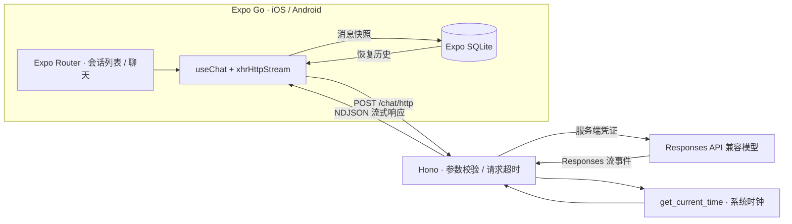

# AI Chat — Expo / React Native MVP

一个面向 iOS 和 Android 的真实流式 AI 聊天应用。基于 Expo SDK 58、React 19、TypeScript、Expo Router、TanStack AI、Hono 和 Expo SQLite；全部新增客户端依赖均可在匹配 SDK 的 Expo Go 中运行，无需自建原生模块。

## 完整功能演示

[](docs/demo/ai-chat-demo.mp4)

**4 分 06 秒 · 1× 原速 · 连续实录 · 12 个章节**

- [观看完整演示（1080p 横屏，带章节说明）](docs/demo/ai-chat-demo.mp4)
- [查看完整竖屏录屏（720p）](docs/demo/ai-chat-portrait.mp4)

iPhone 18 Pro / Expo Go 真实录制。首轮采用较长问题，展示等待、真实思考、正文与代码逐步生成；继续演示上下文追问、复制、编辑与重新生成、停止、工具调用、真实断线重试，以及重启后恢复会话和多行草稿。

**完整视频没有加速、慢放或剪掉等待，也没有模拟模型回复。** 横屏版仅在手机画面外增加章节说明；GIF 是同一次录屏前 40 秒的原速低帧率预览。断线环节实际关闭并恢复 Hono 服务，重启环节实际关闭并重新启动 Expo Go。

| 时间 | 演示内容 |
| --- | --- |
| 00:00 | 真实流式回答 |
| 00:27 | 阅读与内容操作 |
| 00:59 | 保留上下文的追问 |
| 01:11 | 编辑问题并重新发送 |
| 01:26 | 重新生成回答 |
| 01:37 | 主动停止生成 |
| 01:52 | 真实服务端工具 |
| 02:51 | 真实连接失败 |
| 03:05 | 恢复服务后重试 |
| 03:17 | 独立会话与草稿 |
| 03:38 | 关闭应用后恢复 |
| 04:02 | 演示完成 |

## 功能

- 消息气泡与虚拟化 FlatList，多行输入、键盘避让、流式自动跟随；上翻历史时暂停跟随，可一键回到底部。
- 等待/思考/工具/回答四阶段反馈，可展开真实思考过程；停止保留部分内容，失败重试与重新生成不重复用户消息，编辑问题后替换后续对话。
- 助手 Markdown：标题、列表、引用、链接、行内代码和横向滚动代码块；整条问题/回复与代码块均可一键复制，保留文字选择能力。
- SQLite 本地会话列表、新建/删除、自动命名和重启后重新打开历史记录。
- 模型可调用服务端 `get_current_time`，读取真实系统时钟与 IANA 时区；消息内显示调用中、完成、失败或中断，结果以日期和时区展示。
- 不包含演示回复、假 token、伪造工具调用或客户端模型凭证。

## 界面与原生玻璃

采用 Codex / DeepSeek 风格的留白、低饱和灰色消息气泡和克制的蓝色强调；发送、停止、返回、新建、删除、复制、编辑与重新生成均使用图标按钮。iOS 使用 SF Symbols 与 `expo-glass-effect` 原生 Liquid Glass；Android 使用 Material Symbols，旧 iOS / 不支持玻璃的环境及系统“降低透明度”模式使用实色回退。按钮保留至少 44pt 点击范围、中文无障碍标签，以及复制成功/失败的图标和读屏反馈。

复用项目已有 SDK 58 依赖，没有增加客户端原生模块；玻璃材质集中在操作控件与输入栏。兼容性依据 [Expo SDK 58 GlassEffect](https://docs.expo.dev/versions/v58.0.0/sdk/glass-effect/) 和 [Symbols](https://docs.expo.dev/versions/v58.0.0/sdk/symbols/)。

## 架构



TanStack AI 负责 NDJSON 解析、token 累积、消息不可变快照、停止与重试，UI 直接消费状态，避免重复维护两份消息。每个会话独立挂载 `useChat`，会话 ID 同时作为 `threadId` 和 SQLite 主键。

流式输出期间每 500ms 检查新快照并排队写入 SQLite，同时保存草稿与停止/中断状态；完成/停止、后台切换和离开会话时补存。iOS 进入后台时停止本机生成，回到前台后保留内容并提供重新生成入口。SQL 使用参数绑定，写入按顺序执行，删除后晚到的写入不会恢复已删除的会话。

## 本地运行

需要 Node.js 22.13+、npm、匹配 SDK 58 的 Expo Go。仓库使用 `package-lock.json`，命令使用 `npx`。

```sh
npm ci
cp .env.example .env
```

编辑 `.env`，只在服务端配置有效的 `OPENAI_API_KEY`；该变量名由适配器决定，内容可以是 **DeepSeek Key**；默认地址为 `https://api.deepseek.com`，默认模型为 `deepseek-flash`，无需 OpenAI Key。DeepSeek 现已支持 Responses API、流式输出和函数工具（[官方说明](https://api-docs.deepseek.com/guides/responses_api/)）。如使用其他供应商，同时设置正确的 `OPENAI_BASE_URL` 与 `OPENAI_MODEL`，该地址须兼容 Responses API；OpenAI 本身需设为 `https://api.openai.com/v1` 并使用其模型和 Key。

终端一：

```sh
npm run dev:server
# http://localhost:8787/health 应返回 {"ok":true}
```

终端二：

```sh
npm start -- --go
# 按 i / a 打开模拟器，或用 Expo Go 扫码
```

连接地址：

| 运行位置 | Hono 地址 |
| --- | --- |
| iOS Simulator | `http://127.0.0.1:8787`（默认） |
| Android 官方模拟器 | `http://10.0.2.2:8787`（默认） |
| iOS / Android 真机 | `EXPO_PUBLIC_TANSTACK_AI_BASE_URL=http://电脑局域网IP:8787` |

真机和电脑需处于可互访网络，允许防火墙访问 8787 和 Metro 端口。修改公开环境变量后重启 Metro；修改服务端变量或代码后重启 Hono。若端口已占用，关闭旧服务进程，或同时更改 `PORT` 与客户端公开 URL。

`.env` 已被 Git 忽略；`.env.example` 仅含占位符。`EXPO_PUBLIC_*` 会进入客户端包，只能放公开配置，不能放 API Key。项目不需要 EAS 或本地原生构建。

## 验证

```sh
npm run verify               # lint + 客户端/服务端类型检查 + 服务端测试
npx expo-doctor
npx expo export --platform ios --platform android --output-dir /tmp/ai-chat-export
```

九项测试覆盖健康检查、JSON/消息校验、缺少凭证、真实时钟/时区，以及使用真实 SQLite 引擎验证消息往返、参数绑定、有序写入和删除，草稿和中断状态兼容恢复、编辑/重新生成的历史边界、阶段判断，以及真实 SDK 传输协议兼容性；测试不需要模型凭证，也不把测试响应注入产品。

手动验收顺序：

1. 新建会话发送真实问题，观察流式文字；生成中停止，确认保留部分回复且可继续提问。
2. 请求长回答并包含长代码块，确认代码可横向滚动、输入框在键盘上方；上翻历史不被拉回底部。
3. 关闭 Hono 后发送消息，确认错误与重试；重启 Hono 后点击重试，用户消息不重复。
4. 返回列表，重新打开会话；关闭并重启 Expo Go，再打开会话，确认消息一致。
5. 新建另一个会话，确认无串话；删除一个会话，确认重新启动后仍已删除。
6. 问“请查询上海现在的时间”，确认出现实际工具调用结果；用 UTC 时区再问一次。

## 目录

```text
src/app/                  Expo Router 路由：列表、chat/[id]
src/components/chat/      聊天状态消费、消息气泡、Markdown、工具状态
src/data/                 Expo SQLite 适配与可测试的会话存储
server.mts                Hono 监听入口
server/app.mts            校验、模型流、超时和公共错误边界
server/tools.mts          真实时间工具
tests/                   服务端自动验证
```

## 已知限制与待验证项

- 本地开发 MVP，没有登录、服务端会话持久化、限流或多设备同步；Hono 不应直接作为公开生产服务部署。
- 本地 SQLite 未加密；模型端会收到当前会话历史。删除只删除本机记录。
- 请求上限为 1MB / 200 条消息，模型调用上限为 4 轮、120 秒；没有历史摘要或上下文裁剪，长会话可能碰到模型上下文限制。
- 进程被系统强制终止时可能丢失最后约 500ms 或尚未完成写盘的内容，不支持断点续传；已恢复的未完成工具调用显示为中断。
- Markdown 不加载外部图片，不渲染 HTML；链接仅支持 HTTP(S)，代码块没有语法高亮。解析器通过 npm override 固定到已修复旧漏洞的版本。
- 本次仅交付移动端；Web 的 SQLite 需要额外 WASM / COOP / COEP 配置，未纳入验收。
- 默认配置已对接 DeepSeek 官方 Responses 接口，Key 仅保存在服务端；已使用当前开发环境凭证实测完整流式回答、`get_current_time` 工具调用和工具结果后的最终回答成功。请求仍受供应商额度、网络与可用性影响。

本次 iOS 验收使用现有 iPhone 18 Pro（iOS 27.0）与 iPhone Duo（iOS 27.1）上的 Expo Go，通过独立 XCUITest 操作真实 DeepSeek 对话，并读取实际 SQLite 与系统剪贴板核对结果。Android 生产 JS 打包通过，Android 运行时交互尚未完成验收；不能将打包成功等同于 Android 真机或模拟器验收。

详细体验测试矩阵与尚未完成项见 [验收记录](docs/EXPERIENCE-QA.md)。
